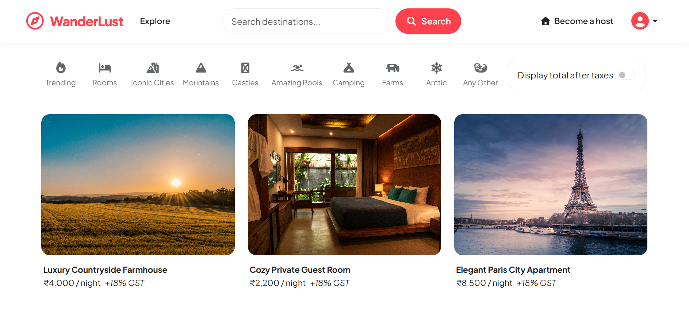
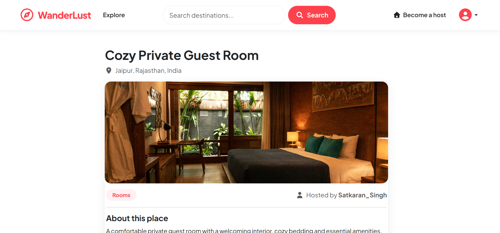
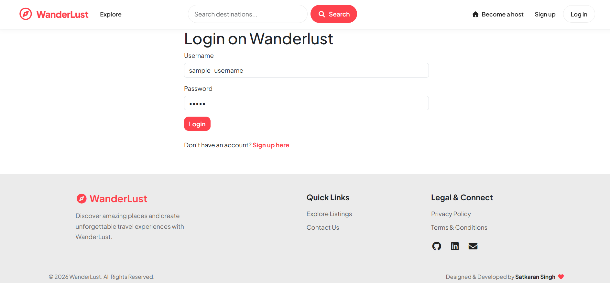
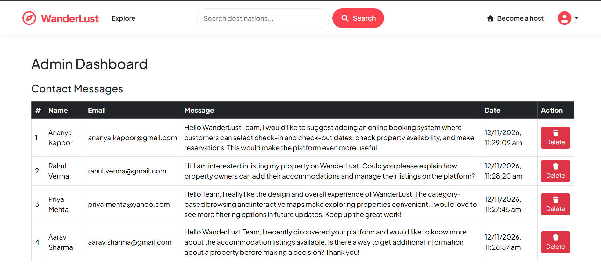

# 🌍 WanderLust
### Discover Places. Experience More. Create Memories.

WanderLust is a full-stack, Airbnb-inspired accommodation listing platform that allows users to explore unique stays, discover destinations, share experiences, and manage property listings.

Built using **Node.js, Express.js, MongoDB, Mongoose, and EJS**, WanderLust provides a responsive interface with user authentication, listing management, reviews and ratings, image uploads, interactive maps, live search, category-based discovery, and administrative functionality.

<p align="center">
  <strong>Discover stays. Explore destinations. Share experiences.</strong>
</p>

<p align="center">
  <a href="https://wanderlust-67zm.onrender.com">
    <strong>🚀 Visit Live Website</strong>
  </a>
  &nbsp; | &nbsp;
  <a href="https://github.com/Satkaran-Singh/WanderLust">
    <strong>📂 GitHub Repository</strong>
  </a>
</p>

---

## 📸 Project Preview

<!-- Add your project screenshots inside the screenshots folder -->

| Homepage | Listing Details |
|:---:|:---:|
|  |  |

| Login Page | Admin Dashboard |
|:---:|:---:|
|  |  |

---

## ✨ Features

### 👤 1. User Authentication & Authorization

- User registration and login.
- Secure password authentication using Passport Local.
- Session-based user authentication.
- Persistent login sessions using MongoDB.
- Protected routes for authenticated users.
- Listing ownership verification.
- Review author verification.
- Role-based access for administrators.

### 🏡 2. Listing Management

- Browse available accommodation listings.
- View detailed property information.
- Create new property listings.
- Edit existing listings.
- Delete owned listings.
- Upload property images.
- Store and manage images using Cloudinary.
- Display property location and country.
- Interactive maps for accommodation locations.
- Display listing prices in Indian Rupees.

### ⭐ 3. Reviews & Ratings

- Add reviews to accommodation listings.
- Submit ratings from 1 to 5 stars.
- Write feedback about listed properties.
- Display reviews on listing detail pages.
- Delete your own reviews.
- Review authorization and validation.

### 🔎 4. Search & Discovery

- Search listings using the search functionality.
- Live search suggestions.
- Browse listings using different categories.
- Filter listings by property categories.
- Explore different destinations.
- Responsive category navigation.
- Tax information toggle on listing prices.

### 🗂️ 5. Property Categories

WanderLust includes 10 accommodation discovery categories:

| Category | Description |
|---|---|
| Trending | Popular and interesting stays |
| Rooms | Comfortable private rooms |
| Iconic Cities | Stays in famous cities |
| Mountains | Mountain and hill destinations |
| Castles | Unique castle accommodations |
| Amazing Pools | Properties featuring swimming pools |
| Camping | Outdoor and camping experiences |
| Farms | Farm stays and countryside properties |
| Arctic | Cold-region and snow destinations |
| Other | Additional accommodation options |

The application currently includes **50 sample listings**, with 5 listings in each category and unique property images.

### 🛠️ 6. Admin Dashboard

- Dedicated administrative dashboard.
- Restricted access for authorized administrators.
- View contact messages submitted by users.
- Manage and delete contact messages.
- Administrative access controls.

### 📩 7. Contact System

- Dedicated contact page.
- Submit messages through a contact form.
- Store contact submissions in MongoDB.
- View submitted messages through the admin dashboard.
- Manage contact messages.

### 🎨 8. User Interface & Experience

- Responsive design using Bootstrap 5.
- Custom-designed navigation bar.
- Consistent primary color theme.
- Responsive listing cards.
- Improved listing detail pages.
- Styled login and registration forms.
- Styled contact, edit listing, and new listing forms.
- Custom success and error flash messages.
- Custom error page.
- Responsive footer.
- Custom favicon.
- Privacy Policy and Terms and Conditions pages.

### 🔐 9. Validation & Security

- Server-side validation using Joi.
- Form validation using Bootstrap.
- Authentication and authorization middleware.
- Listing ownership checks.
- Review ownership checks.
- Centralized error handling.
- Custom Express error handling.
- Flash messages for user feedback.
- MongoDB-backed session storage.

---

## 🧰 Technology Stack

### Frontend

- HTML5
- CSS3
- JavaScript
- EJS (Embedded JavaScript Templates)
- Bootstrap 5
- Font Awesome

### Backend

- Node.js
- Express.js
- MongoDB
- Mongoose

### Authentication & Security

- Passport.js
- Passport Local
- Passport Local Mongoose
- Express Session
- Connect Mongo
- Connect Flash
- Joi

### Image Upload & Maps

- Cloudinary
- Multer
- Mapbox

### Deployment & Version Control

- Render
- MongoDB Atlas
- Git
- GitHub

---

## 🏗️ Project Structure

```text
WanderLust/
│
├── controllers/
│   ├── admin.js
│   ├── contacts.js
│   ├── listings.js
│   ├── reviews.js
│   └── users.js
│
├── init/
│   ├── data.js
│   ├── index.js
│   ├── createReviewers.js
│   └── createReviews.js
│
├── models/
│   ├── contact.js
│   ├── listing.js
│   ├── review.js
│   └── user.js
│
├── public/
│   ├── css/
│   │   └── style.css
│   ├── js/
│   └── favicon.svg
│
├── routes/
│   ├── admin.js
│   ├── contact.js
│   ├── listing.js
│   ├── review.js
│   └── user.js
│
├── utils/
│   ├── ExpressError.js
│   └── flashRedirect.js
│
├── views/
│   ├── admin/
│   ├── contacts/
│   ├── includes/
│   ├── layouts/
│   ├── listings/
│   ├── users/
│   ├── error.ejs
│   ├── privacy.ejs
│   └── terms.ejs
│
├── app.js
├── cloudConfig.js
├── middleware.js
├── schema.js
├── package.json
├── package-lock.json
├── .env.example
└── README.md
```

---

## ⚙️ Installation & Setup

Follow these steps to run WanderLust locally.

### 1. Clone the Repository

```bash
git clone https://github.com/Satkaran-Singh/WanderLust.git
```

### 2. Navigate to the Project Directory

```bash
cd WanderLust
```

### 3. Install Dependencies

```bash
npm install
```

### 4. Configure Environment Variables

WanderLust requires environment variables to connect with MongoDB Atlas, Cloudinary, and other external services.

Create a `.env` file in the root directory.

Refer to `.env.example` for the required variable names.

Configure the following variables:

```env
ATLASDB_URL=your_mongodb_atlas_connection_string
SECRET=your_session_secret

CLOUD_NAME=your_cloudinary_cloud_name
CLOUD_API_KEY=your_cloudinary_api_key
CLOUD_API_SECRET=your_cloudinary_api_secret
```

**Important:**
- Replace the placeholder values with your own credentials.
- Configure your MongoDB Atlas database and Cloudinary account.
- Keep your `.env` file private.
- Never upload your actual credentials to GitHub.

### 5. Start the Application

```bash
npm start
```

Open your browser and visit:

```text
http://localhost:8080
```

---

## 🗄️ Database

WanderLust uses **MongoDB Atlas** for cloud-based data storage and **Mongoose** for object data modeling.

The application maintains separate models and collections for:

| Collection | Purpose |
|---|---|
| Users | Stores user authentication and account information |
| Listings | Stores accommodation details and ownership |
| Reviews | Stores ratings, comments, and review authors |
| Contacts | Stores messages submitted through the contact form |
| Sessions | Stores persistent user sessions |

### Sample Database Data

The project includes sample data for testing and demonstration:

- 50 accommodation listings.
- 10 property categories.
- 5 listings in each category.
- 50 unique listing images.
- 15 sample reviewer accounts.
- 250 sample reviews.

The sample reviews and accounts are demonstration data, not genuine customer feedback.

---

## ☁️ Deployment

WanderLust is deployed using Render with MongoDB Atlas and Cloudinary as external services.

| Service | Purpose |
|---|---|
| Render | Application hosting |
| MongoDB Atlas | Cloud database |
| Cloudinary | Image storage and management |
| Mapbox | Interactive maps |

**Live Application:**
https://wanderlust-67zm.onrender.com

---

## 🔮 Future Improvements

WanderLust can be extended into a more complete accommodation booking and property management platform.

Planned improvements include:

### 🗓️ 1. Accommodation Booking System

- Allow customers to book available properties.
- Select check-in and check-out dates.
- Select the number of guests.
- Check property availability.
- Prevent overlapping bookings.
- View booking history and reservation status.
- Allow users to cancel bookings according to booking policies.

### 💳 2. Online Payment Integration

- Integrate a secure payment gateway.
- Support online booking payments.
- Generate payment confirmations.
- Provide downloadable booking receipts.
- Manage refunds and payment status.

### 🏠 3. Host Management System

- Dedicated host dashboard.
- Manage property availability.
- View incoming booking requests.
- Accept or reject reservations.
- Manage property pricing.
- Track earnings and booking history.

### 📊 4. Advanced Admin Dashboard

- Manage users, hosts, and properties.
- Monitor reservations and payments.
- Manage reported listings and reviews.
- View platform statistics.
- Generate revenue and booking reports.

### 🤖 5. AI-Powered Recommendations

- Recommend properties based on user preferences.
- Personalized destination suggestions.
- Smart property discovery.
- Recommendation systems using machine learning.

### 📍 6. Advanced Search & Filtering

- Filter by price range.
- Filter by location and amenities.
- Filter by guest capacity.
- Filter by availability.
- Sort by price, ratings, and popularity.

### 📱 7. Further User Experience Improvements

- Improve mobile responsiveness.
- Add email notifications.
- Add booking reminders.
- Improve accessibility.
- Introduce additional property discovery features.

---

## 👨‍💻 Author

**Satkaran Singh**

B.Tech Computer Science & Engineering

- GitHub: https://github.com/Satkaran-Singh
- LinkedIn: https://www.linkedin.com/in/satkaran-singh-41800b31a/

---

## 🙏 Acknowledgements

- Inspiration from Airbnb.
- Sigma 12 Full Stack Web Development learning program.
- Open-source technologies and developer communities.

---

<p align="center">
  <strong>Made with ❤️ by Satkaran Singh</strong>
  <br>
  WanderLust — Discover your next destination.
</p>